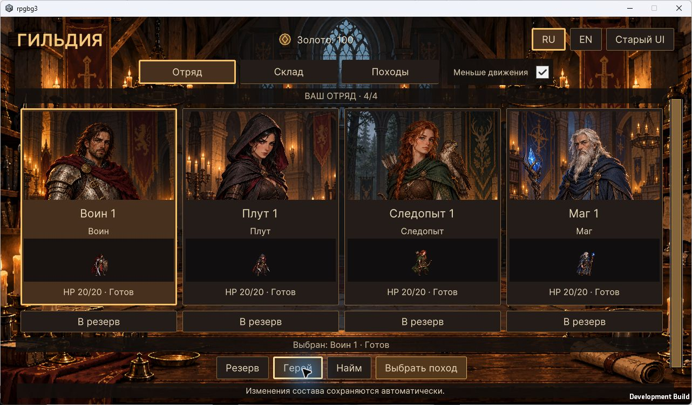
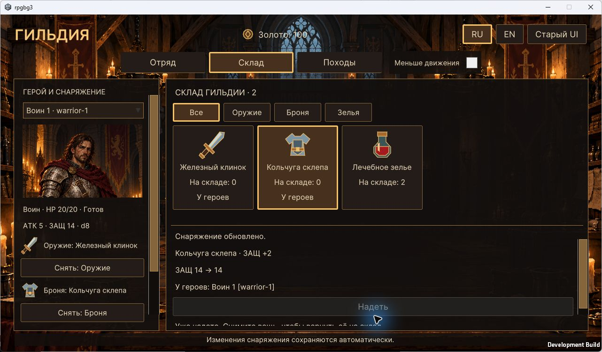

# WP-42 — протокол приёмки (частично)

Проверки 17–18.10.2026, Unity 6000.2.8f1. Статус `[~]`.
Полная ручная приёмка Windows player не завершена.

## Изменения

- `ProjectSettings.asset`: разрешено изменение размера окна Windows player.
  В исходной сборке кнопка разворачивания была недоступна. Настройка исправлена,
  но её ручная проверка в пересобранном player ещё не выполнена.
- `GuildMenuMotion.cs`: устаревшие transform.scale/position заменены на
  style.scale/translate. Повторная проверка анимаций и уменьшения движения прошла;
  четыре предупреждения CS0618 устранены.
- `GuildSaveLocation.cs`, `GameBootstrap.cs`: Development Build допускает
  `--qa-save <путь>` для отдельного файла гильдии. Обычная сборка игнорирует флаг.
  Проверены выбор пути и отказ для относительного пути; обычное сохранение
  не используется ручным тестом. Предпочтения языка/движения остаются общими.
- `AcceptanceSetup.cs`: подготовка отдельного сохранения с базовым запасом
  оружия, брони и двух зелий. Это начальная фикстура для проверки экипировки,
  не изменение игровых правил или нормального стартового инвентаря.
- `FullLoopAcceptance.cs`: сквозная проверка реального боя без подмены урона,
  позиций, бросков, наград и принудительного завершения действий.
- Unity обновила maxTextureSize в метаданных семи атласов до 4096 в соответствии
  с уже существующим UnitSpriteImporter; новых изображений не добавлялось.

## Пройденные проверки

Прошли UiFoundationChecks, GuildPartyChecks, GuildHeroChecks, GuildStorageChecks,
GuildMotionChecks, GuildDepartureChecks, BattleHudChecks, BattleActionChecks,
JourneyScreenChecks и полный HexPresentationChecks. Они покрывают RU/EN,
1280×720/1920×1080, длинную подпись героя, ошибки, фокус/Esc, уменьшение
движения, повторные открытия, сохранения, награды и возврат тел.

FullLoopAcceptance прошёл маршрут «склад → экипировка настоящей кнопкой →
отправка → два участка с настоящим боем → добыча → гильдия → склад → загрузка
оплаченного сохранения»: 26 атак, 161 команда. Начальный инвентарь задавался
фикстурой; боевые HP, урон, позиции и награды не подменялись. Ходьба использовала
нулевую длительность анимации, поиск маршрута — полную карту как тестовый
планировщик; разрешение команд и текущую видимость проверяла настоящая модель.
Этот сценарий автоматизирован и не является ручным прохождением player.

При первом общем прогоне добавление тестового файла вызвало перекомпиляцию
во время Play Mode и потерю несериализуемого состояния. Повтор после завершения
редактирования прошёл полностью. Это не засчитывалось как успешный первый прогон.

Windows BuildChecks сначала собрал player с четырьмя предупреждениями об
устаревшем UI API. После исправления повторная сборка прошла с **0 ошибками,
0 предупреждениями**. Прежняя блокировка UnityLinker политикой Device Guard
не воспроизвелась. Выход: `Builds/UnityValidation/GuildTactics.exe` (Development
Build, генерируемые файлы не хранятся в Git).

Логи в игнорируемой папке Logs:

- `wp42-<имя проверки>.log` — проверки отдельных экранов;
- `wp42-FullLoopAcceptance-final.log` — настоящий сквозной бой;
- `wp42-HexPresentationChecks-final.log` — общий повтор;
- `wp42-GuildMotionChecks-resize.log` — анимации после исправления API;
- `wp42-BuildChecks-resize.log` — финальная сборка без предупреждений.

## Ручной прогон Windows player

Игра запускалась в окне 1280×720 с отдельным `Logs/wp42-manual-save.json`.
Мышью проверены склад, надевание меча и брони: ATK 4 → 5, кость d6 → d8,
защита 12 → 14, количество предметов на складе уменьшилось. Карточка героя
показала те же значения. Esc закрыл карточку и вернул фокус на кнопку героя.
Переключение RU/EN и настройка уменьшения движения сработали.

Проверка разворачивания первого player выявила запрет изменения размера окна.
После исправления player пересобран и повторно запущен с тестовым сохранением,
однако следующий вызов Computer Use был остановлен физическим Esc пользователя.
После остановки дополнительных действий в интерфейсе не выполнялось.
При завершении этого прогона могли остаться EN и включённое уменьшение движения;
это предпочтения интерфейса, отдельный файл гильдии их не изолирует.

## Осталось для завершения WP-42

- В пересобранном player проверить изменение окна, разворачивание и адаптацию HUD.
- Мышью и клавиатурой проверить отправку, движение/прицеливание/атаку, отмену,
  смену хода и блокировку карты под модальными окнами.
- Довести ручной сценарий player до результата и возврата награды на склад;
  проверить повторное открытие и загрузку. Для отдельных переходов подготовлен
  `Logs/wp42-manual-boundary.json` из настоящего автоматического прохождения,
  но ручной тест этой контрольной точки ещё не выполнялся.
- Проверить журнал player на ошибки после этих действий и завершить протокол.
- Только затем менять статус на `[x]` и решать вопрос удаления старой презентации
  из обычного пути. Старые экраны и отладочные средства сейчас сохранены.

