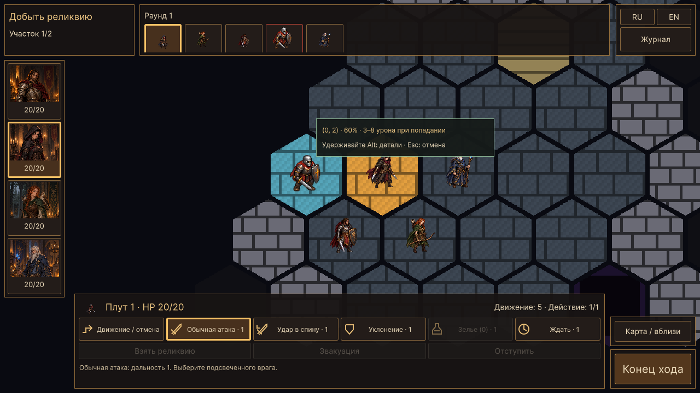
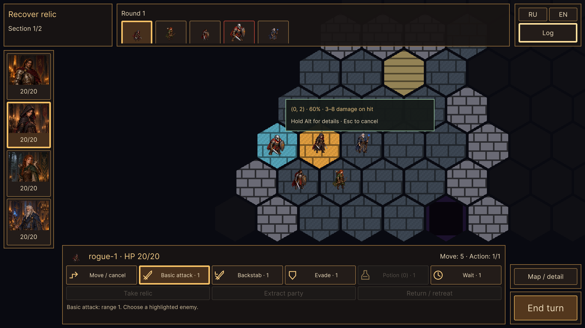
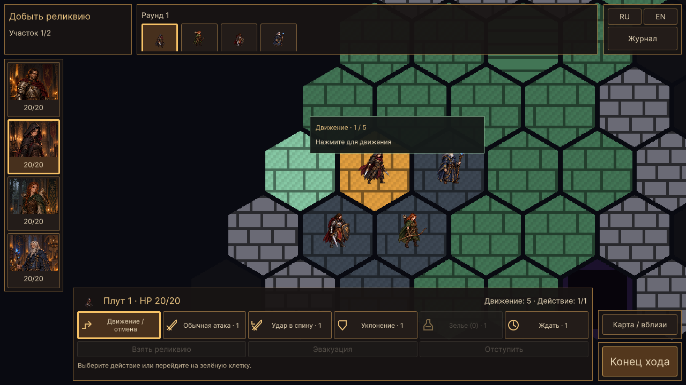
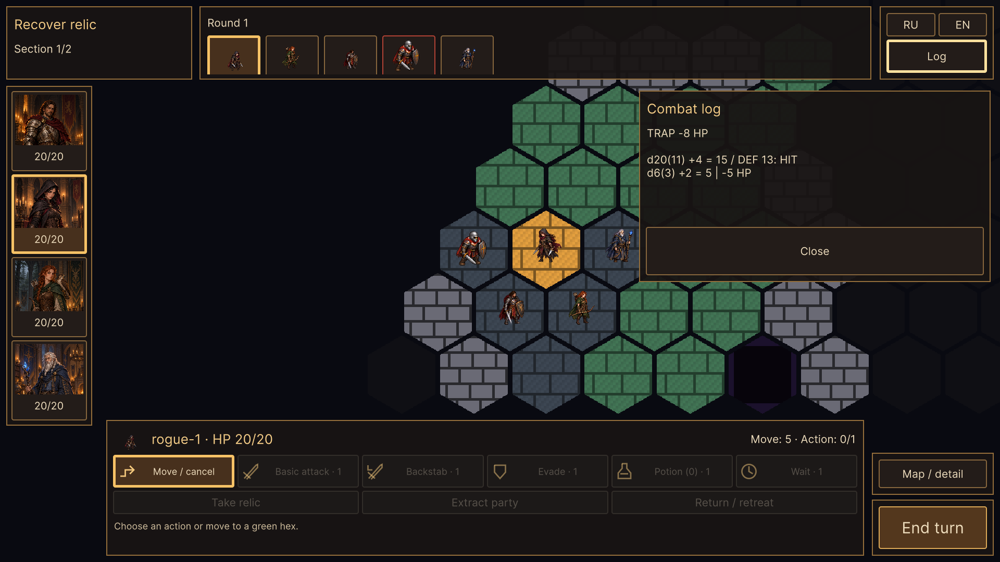

# WP-40 — действия, прогноз и боевой отклик

Реализация: 17.10.2026, Unity 6000.2.8f1.

В нижней панели появились отдельные векторные символы существующих команд,
выделение выбранной атаки/способности и цена в одно действие. Движение расходует
свои очки. Наведение на кнопку показывает описание и причину недоступности;
для отключённых кнопок сохранена отдельная доступная поверхность наведения.
Отмена через Esc работает и после взаимодействия с картой. Один Esc закрывает
осмотр/журнал, следующий отменяет выбор действия.

При наведении на доступную клетку показываются путь и его стоимость. Выбранная
атака или способность использует существующую подсветку допустимых целей.
Рядом с целью выводятся точный шанс и диапазон урона **при попадании**;
удержание Alt раскрывает формулу и цену. Обычная атака также прогнозируется
при наведении на видимого врага без предварительного выбора кнопки.
Push сообщает о смертельном падении в яму. У остальных эффектов без броска
показывается описание способности, без выдуманного процента попадания.

Прогноз не является командой: он не расходует действие, движение, HP или RNG.
`CombatSystem.CanAttack` и `AbilitySystem.CanUse` остаются валидаторами команд.
`AttackForecast` содержит арифметику, общую с `PrepareAttack`: точность,
текущую защиту, фактическую кость оружия и насыщение целочисленных бонусов.
Шанс перебирает все 20 исходов: натуральные 1/20 не получают новых правил.
Площадной прогноз использует тот же список видимых целей и проверку стен,
что исполнение Fire Burst. Контроллер отсекает невидимые клетки до чтения
занятости. Путь не рисуется через невидимые клетки.

В новом HUD всплывающий результат сокращён до d20, попадания/промаха и
применённого урона/гибели; эффекты сохраняют короткие сообщения. Геометрия
ограничена безопасной областью карты. «Журнал» хранит последние 40 сообщений
текущего боя с полными бросками и формулами; язык переключается и для истории.
История принадлежит CombatText конкретного контроллера, не переносится между
походами и не сохраняется в файл. Старый HUD сохраняет подробный вывод.

Повторный клик проходит существующую блокировку разрешения действия и повторную
валидацию модели. Новых способностей, изменений баланса и схемы сохранений нет.
Оформление событий и итогов похода остаётся WP-41.

## Изменённые файлы

- `AttackForecast.cs`, `CombatSystem.cs` — общий расчёт и объяснение отказов.
- `AbilitySystem.cs`, `PlayerUnitController.cs` — проверенный read-only прогноз.
- `HexGridView.cs` — дополнительная подсветка пути.
- `ActionIcon.cs`, `BattleHud.cs`, `BattleHud.uss` — символы, состояния,
  стоимость, наведение, Esc и журнал.
- `CombatText.cs` — короткое отображение и ограниченная история.
- `ActionForecastChecks.cs`, `BattleActionChecks.cs`, `HexPresentationChecks.cs` —
  проверки модели, реальной сцены и подключение к общему runner.
- Дорожная карта, README, AGENTS и технические заметки — состояние пакета.

## Проверки

`GuildTactics.Editor.BattleActionChecks.RunBatch` — `-batchmode`, без `-quit`
и `-nographics`, изолированная гильдия, запись пользовательского сохранения
отключена. Модель проверяет 80 исходов обычной атаки четырёх классов,
вероятности 0/100%, переполнение и нулевой урон, восемь способностей,
повторное наведение, границу дальности, стену, туман войны, состав площади,
расход ресурсов и запрет двойного исполнения.

Play Mode проверяет настоящую сцену и HUD: стоимость/иконки/выбор, путь,
прогноз и подписи RU/EN в 1280×720 и 1920×1080, скрытые цели, отмену,
совпадение фактического броска с прогнозом, двойной вызов, причину отключения
через поверхность наведения, историю и сохранность Unity/боевого RNG.
Боевой RNG сравнивается с исходным seed до настоящей атаки; затем атака
проверяется против своего фактического броска. Курсор в batch подаётся через
тот же ProcessPointer; тестовый LateUpdate поддерживает наведение между кадрами.
Первый UI-прогон уточнён: проверка потраченного действия ждёт окончания
реальной анимации, чтобы отличать разрешение действия от доступного хода.

BattleActionChecks и общий HexPresentationChecks прошли. BattleHudChecks
прошёл регрессию прежнего HUD. Снимки пути, цели и журнала просмотрены.
Логи: `Logs/wp40-actions-final.log`, `Logs/wp40-regression.log`,
`Logs/wp40-hud-regression.log`. Ручное прохождение мышью/клавиатурой и
отдельная Windows-сборка не выполнялись; полная приёмка player остаётся WP-42.

