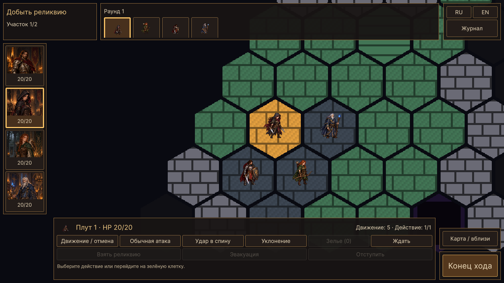
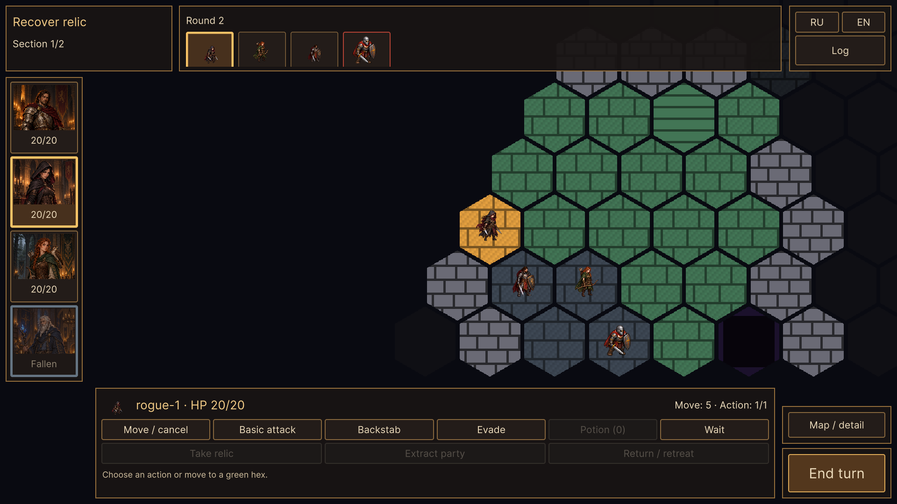

# WP-39 — боевой HUD

Реализация: 17.10.2026, Unity 6000.2.8f1.

Обычный запуск экспедиции открывает новый runtime UI Toolkit HUD:

- слева — четыре портрета отряда, HP, активный боец и отметка погибшего;
- сверху по центру — инициатива с игровыми миниатюрами, раунд и ход врага;
- сверху слева — короткая цель и участок; подготовка удара босса имеет предупреждение;
- снизу по центру — активный боец, HP, движение/действие и существующие команды;
- справа снизу — отдельный конец хода и переключение обзора/крупного плана;
- справа сверху — RU/EN и свёрнутый «Журнал» с существующим последним боевым результатом.

Композиция сверена с `UI_REFERENCES/battle.png`: карта занимает основное место,
постоянной правой панели характеристик нет. Визуализация карты и игровые спрайты
остались существующими. Иконки действий, прогнозы и новая обратная связь — WP-40.

Нажатие на портрет или доступный элемент очереди открывает краткий осмотр.
Выбор активного героя использует текущий TrySelectUnit; осмотр остальных не
изменяет SelectedUnit, очерёдность, движение или действие. Погибший остаётся в
портретах отряда, но исчезает из очереди. Невидимые враги не появляются в очереди,
и их данные не выводятся в осмотре/панели активного бойца. Если осматриваемый враг
скрылся, осмотр закрывается. Ход скрытого врага обозначается общим текстом.

Длинная очередь прокручивается горизонтально; переход хода показывает активного
видимого бойца. Осмотр и обновление данных сохраняют ручную позицию прокрутки.
Миниатюры используют общий UnitMiniature/UnitSpriteSheet из WP-37. Настройка
уменьшения движения применяется и к ним; скрытый HUD не обновляет анимации.
Фокус обозначен холодной рамкой, активный ход — золотой.

## Команды и совместимость

Кнопки вызывают существующие методы PlayerUnitController: движение/отмена,
обычная атака, две способности класса, зелье, ожидание и конец хода. Доступность
берётся из CanPlayerAct, TurnManager и ConsumableSystem. Игровая формула,
подсветка клеток, туман войны, расход RNG и экономика действий не менялись.
Обработчик фиксирует экран, контроллер и номер хода; после команды выключает
старые кнопки до обновления. Повторное/устаревшее событие не завершает второй ход.

Реликвия, эвакуация и отступление доступны из нижней панели по существующим
условиям. Подтверждения потери тел и отступления передаются ExpeditionUI;
новый HUD на время уступает им экран. События границы и результаты также
сохраняют текущую презентацию до WP-41. Повторный поход привязывает HUD к новому
контроллеру, очищая старый осмотр/журнал. Схема сохранений не менялась.

Старые TurnOrderUI, ActionBarUI, строка характеристик контроллера и подписи
камеры не рисуются одновременно с новым HUD. Batch-фикстуры по умолчанию
используют прежнюю презентацию, а BattleHudChecks явно открывает новую.
Debug Mode позволяет перейти к «Старому HUD» и вернуться кнопкой HUD (WP-39),
сохраняя прежние отладочные средства.

## Камера и ввод

BattleHud измеряет фактические прямоугольники панелей после раскладки и переводит
их из координат UI в пиксели камеры. Постоянные панели задают MapScreenRect;
обзор вписывает туда карту, крупный план центрирует выбранную клетку в этой
области. Смена размера/языка и высоты предупреждения обновляет границы.

UiInputGate.BlocksPointer проверяет все видимые панели, включая осмотр и журнал.
HexGridInteraction использует тот же путь для наведения, клика, колеса и начала
перетаскивания; вход курсора на HUD прекращает перетаскивание. Свободное место
экрана пропускает ввод на карту. Закрытие/отключение возвращает старую область
камеры. Маркеры целей и полоски HP учитывают панели новой презентации.

## Файлы

- `BattleHud.cs`, `BattleHud.uss` — отображение состояния, осмотр, очередь,
  команды, анимация и измерение геометрии.
- `UiInputGate.cs`, `HexGridInteraction.cs` — единое исключение указателя и
  адаптивная безопасная область, вписывание/приближение/перемещение камеры.
- `GameBootstrap.cs` — отдельный корень UIDocument, владение и повторная привязка.
- `TurnOrderUI.cs`, `ActionBarUI.cs`, `PlayerUnitController.cs`, `UnitView.cs`,
  `ExpeditionUI.cs` — переключение презентации, существующие диалоги и маркеры.
- `BattleHudChecks.cs` — реальная сцена, команды UI, камера и снимки Play Mode.

## Проверки

`GuildTactics.Editor.BattleHudChecks.RunBatch` запускается с `-batchmode`,
без `-quit` и `-nographics`, с изолированной гильдией и отключённой записью
пользовательского сохранения. Проверяются:

- точная видимая живая очередь, активный боец, гибель героя/врага и 12 участников;
- общий атлас активной миниатюры, сохранение/автопрокрутка длинной очереди;
- осмотр союзника/врага, невозможность украсть ход врага, закрытие через Esc;
- текущие выбор атаки/отмена/ожидание/конец хода и повторные события;
- блокировка наведения, кликов, зума/перемещения на каждом прямоугольнике HUD;
- настоящий клик по свободной карте и движение через контроллер;
- вписывание всех клеток в измеренную область, приближение и перемещение камеры;
- журнал, RU/EN при 1280×720 и 1920×1080, размеры и переносы текста;
- неизменность Unity RNG и 32 броска настоящего боевого потока против seed;
- старый/новый HUD, подтверждение отступления, возврат и новый поход, отключение.

Для изоляции проверки двойного конца хода фикстура выбирает seed, у которого
первые два хода принадлежат игроку. ИИ между ними иначе законно добавляет ходы.
Позиции для отдельных сценариев устраиваются через модель; управление и события
UI проходят настоящие команды. Первоначальный запуск CharacterCameraChecks с
`-nographics` завершился сбоем при Camera.Render; графический повтор прошёл.

Логи: `Logs/wp39-hud.log`, `Logs/wp39-camera.log` и регрессии
`wp39-party-regression.log`, `wp39-hero-regression.log`,
`wp39-storage-regression.log`, `wp39-motion-regression.log`,
`wp39-departure-regression.log`, `wp39-regression.log`.
Ручной прогон мышью и отдельная Windows-сборка в этом пакете не выполнялись.

Результат: BattleHudChecks, CharacterCameraChecks, регрессии WP-34–38 и полный
общий runner WP-00–19/WP-21–32 прошли. Снимки RU/EN, хода врага, осмотра,
погибшего бойца и длинной очереди просмотрены визуально. Геометрия соответствует
целевой композиции референса; существующая 2D-карта сохранена.

