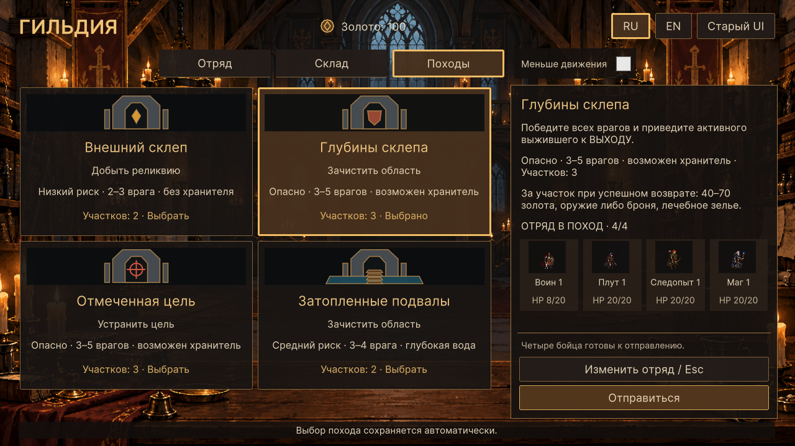
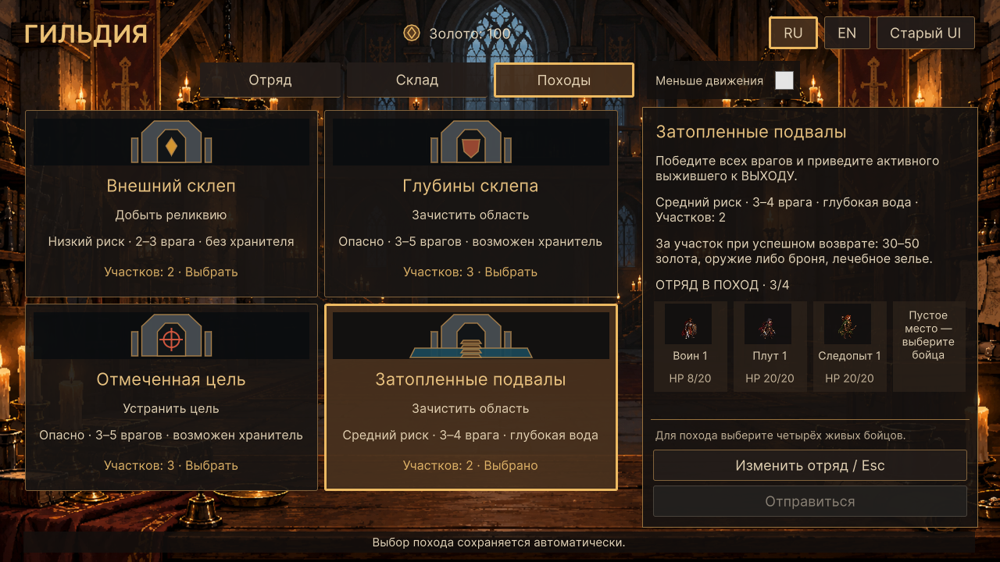

# WP-38 — выбор похода и отправка

Реализация: 17.10.2026, Unity 6000.2.8f1.

Вкладка «Походы» показывает четыре существующих предложения: внешний склеп,
глубины склепа, отмеченную цель и затопленные подвалы. Каждое имеет отдельную
карточку с оригинальной векторной виньеткой, названием, типом задания,
существующей оценкой сложности, количеством участков и явной отметкой выбора.
Виньетки обозначают направление и тип задания, а не показывают будущую карту.

Справа — цель выбранного похода, сложность и награда **за участок при успешном
возвращении**. Диапазон золота, выдача предметов и число участков берутся из
ExpeditionOffer/MissionDefinition. Новые гарантии награды, враги и походы не
добавлены. Для реликвии требуется забрать её и выйти, для охоты — уничтожить
отмеченную цель, для зачистки — всех врагов. Условие активного выжившего у выхода
сохранено. Поле показывает краткое описание, не дублирует расчёт генератора.

Ниже видно четыре отправляющихся героя с миниатюрами тех же атласов, именами
и текущим HP. В неполном отряде показаны пустые места. Изменение состава
доступно через **«Изменить отряд / Esc»**; возвращение восстанавливает фокус
на кнопке выбора похода, если она доступна. Выбор экспедиции сохраняется при
смене вкладок, возврате к отряду и загрузке существующего сохранения.

Одна кнопка **«Отправиться»** запускает существующий GameBootstrap API.
Без четырёх выбранных живых бойцов она отключена с видимой причиной. После
отправки гильдия скрывается, игровой ввод передаётся бою. После возвращения
можно снова выбрать поход и отправить выживших или изменённый состав.

## Реализация и границы

- `GuildExpeditions.cs` — отдельная часть GuildPartyScreen: предложения,
  подробности, состав, возврат и отправка; заменяет временный BuildBridge.
- `ExpeditionIllustration.cs` — независимые элементы UI Toolkit Painter2D:
  склеп с реликвией, зачистка, метка охоты и деревянный переход над водой.
- `GuildExpeditions.uss` — две колонки, сетка карточек, компактный состав,
  прокручиваемые предложения/подробности и постоянно доступные кнопки справа.
- `GuildPartyScreen.cs` — вкладка, стили, Esc, сохранение и очистка обратной связи.
- `GuildDepartureChecks.cs` — реальные события UI и переходы в Play Mode.

Выбор вызывает TrySelectExpedition, отправка — TryLaunchExpedition.
Перед отправкой обработчик фиксирует экземпляр экрана, гильдию, модель выбора
и индекс показанного похода. При смене выбора до перерисовки отправка отклоняется
с предложением проверить новое описание. При изменении состава команда заново
проверяется моделью. Кнопки отключаются сразу, до следующего Update, поэтому
двойное событие не создаёт вторую сцену и не сдвигает seed дважды. Отсоединённая
старая кнопка не работает после возврата даже при полном готовом составе.

Схема сохранений, ExpeditionSelection, генераторы, баланс и правила миссий не
изменялись. Миниатюры используют общий компонент WP-37 и его часы/уменьшение
движения. Новый боевой HUD относится к WP-39 и в этом пакете не начинался.

## Проверки

`GuildTactics.Editor.GuildDepartureChecks.RunBatch` запускается с `-batchmode`,
без `-quit` и `-nographics`. Фикстуры изолированы от пользовательского сохранения.
Проверяются:

- все четыре карточки, цель/диапазон награды/участки из реальных предложений;
- сохранение/загрузка выбранного похода и следующего seed;
- состав из 0/3/4 героев, отображение ранений и пустых мест;
- вкладки, возврат, Esc и восстановление фокуса;
- смена похода или состава перед нажатием старой кнопки;
- двойное событие, ровно один запуск и один сдвиг seed;
- фактическая миссия, биом, количество участков, отправленные ID и HP;
- четыре цикла «поход → отступление у выхода → та же гильдия → следующий поход»
  с теми же выжившими, без подмены гильдии между этими запусками;
- невозможность повторного запуска отсоединённой кнопкой после возвращения;
- RU/EN в 1280×720 и 1920×1080, размеры элементов и отсутствие обрезки текста.

Логи: `Logs/wp38-departure.log`, `Logs/wp38-party-regression.log`,
`Logs/wp38-hero-regression.log`, `Logs/wp38-storage-regression.log`,
`Logs/wp38-motion-regression.log`, `Logs/wp38-regression.log`.
Снимки: `Logs/wp38-*.png`. Ручной прогон мышью и отдельная Windows-сборка
в этом пакете не выполнялись.

Результат: все указанные проверки прошли. Снимки 1280×720 RU и 1920×1080 EN,
а также неполный состав просмотрены визуально. Проверка сравнивает состав
по ID: порядок внутри ExpeditionRun соответствует инициативе, а не порядку
карточек гильдии.

