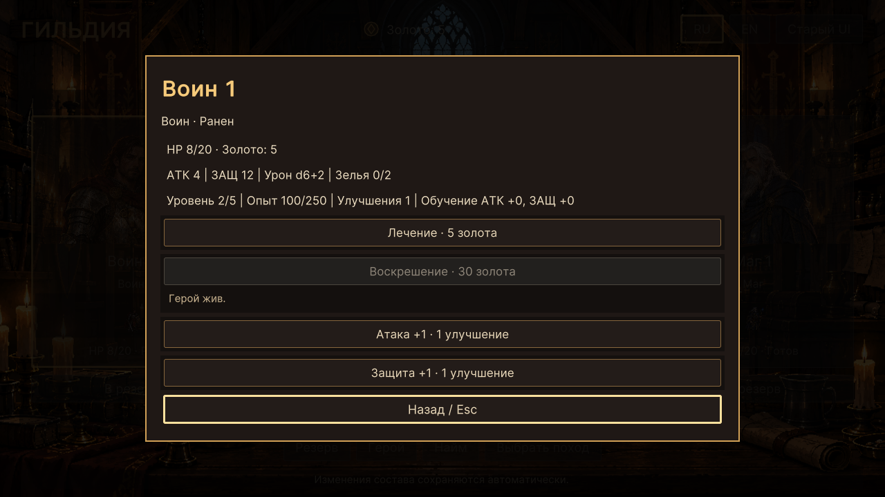
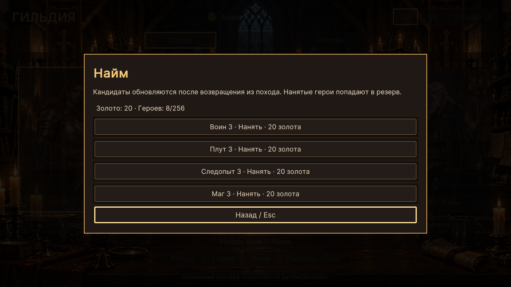

# WP-35 — герой, найм и развитие

Реализация: 16.10.2026, Unity 6000.2.8f1.

На экране отряда выберите героя и нажмите «Герой». В резерве доступны
«Подробнее» у каждого бойца, включая погибших и окончательно потерянных.
Панель показывает класс, состояние, HP, атаку, защиту, урон, зелья,
уровень, опыт, обучение и оставшиеся улучшения.

Лечение стоит 5 золота, воскрешение возвращённого тела — 30. Улучшение атаки
или защиты расходует одно существующее очко развития. Неактивные кнопки
сопровождаются видимой причиной: полное здоровье, нехватка золота, отсутствие
улучшений или недопустимое состояние героя. Потерянные навсегда не воскресают.
Воскрешённого героя нужно явно добавить в отряд из резерва.

«Найм» открывает текущих кандидатов по 20 золота. Нанятый герой выбирается
по ID и поступает в резерв; состав отряда не меняется. После исчерпания
кандидатов показано пустое состояние. При невозможности восстановить отряд
есть «Новая гильдия…» с отдельным подтверждением замены прогресса.
Esc отменяет подтверждение, сохраняя старую гильдию.

Esc/«Назад» закрывает подробности с возвратом фокуса на открывшую кнопку,
сохраняя выбор героя. Подробности из резерва возвращают в резерв к тому же
бойцу и позиции прокрутки. Содержимое панелей прокручивается при недостатке
высоты; закрытие остаётся доступно. Tab/Shift+Tab удерживается в текущем окне.

## Реализация и границы

`GuildHeroPanels.cs` — отдельная часть GuildPartyScreen с построением панелей.
GuildPartyScreen хранит вид открытого окна и выбранный ID; общие компоненты
и стили WP-33/34 переиспользованы. Команды используют только `TryHeal`,
`TryResurrect`, `TryUpgrade`, `TryHire` и `TryStartNewGuild`.

После команды retained-кнопки сразу выключаются, до отложенной перестройки
в Update. Это не даёт повторному событию списать второе очко развития или
вторую оплату. Успешная и отклонённая команды обновляют значения и причины
недоступности. На отказе есть обратная связь. Замена модели гильдии закрывает
старые панели, переносит подписку и выбирает существующего героя.

Новые классы, правила развития/воскрешения и схема сохранения не добавлены.
Экипировка остаётся в старом интерфейсе до WP-36. Миниатюры пока статичны
до WP-37. Коммит и push в этом запросе не выполнялись.

## Проверки

`GuildTactics.Editor.GuildHeroChecks.RunBatch` запускается без `-quit` и
`-nographics`, использует Play Mode, реальные NavigationSubmitEvent, временные
файлы и существующую проверку сохранений. Проверены:

- лечение при 4/5 золота, воскрешение при 29/30, найм при 19/20;
- двойное событие оплаты и улучшения, в том числе при двух свободных очках;
- отклонение устаревшей команды после изменения модели;
- живой, раненый, возвращённое тело, окончательно потерянный;
- сохранение/загрузка золота, HP, обучения, статуса, состава и кандидатов;
- отсутствие живых бойцов, найм всех четырёх кандидатов, пустые предложения;
- подтверждение и отмена новой гильдии;
- выбор героя, Esc, возврат фокуса и открытие подробностей из резерва;
- RU/EN в 1280×720 и 1920×1080, размеры окна и отсутствие обрезки текста.

Результат: `Logs/wp35-hero.log`, снимки `Logs/wp35-*.png`. Снимки панелей
героя и найма просмотрены визуально. Регрессия WP-34 —
`Logs/wp35-party-regression.log`, общая игровая регрессия —
`Logs/wp35-regression.log`. Ручной прогон мышью и отдельная Windows-сборка
в этом пакете не выполнялись.

