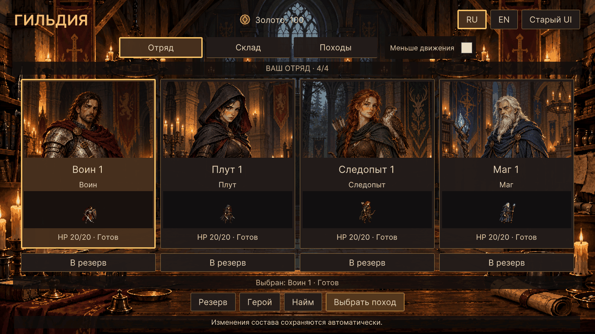

# WP-37 — живое меню и миниатюры

Реализация: 17.10.2026, Unity 6000.2.8f1.

В отряде под иллюстрациями проигрывается Idle всех четырёх классов. Выбор героя
даёт короткую реакцию существующими кадрами Defend, затем возвращает Idle.
Это визуальный отклик: действие боя не выполняется, HP и ресурсы не расходуются.
Миниатюры используют те же Hero art V2, что бойцы на карте. Для читаемости полоса
спрайта увеличена с 64 до 80 px, а иллюстрация уменьшена на те же 16 px — высота
карточек, подписи и зоны нажатия сохранены.

Иллюстрации в отряде и на складе едва двигаются внутри неподвижного обрезающего
контейнера. Отдельный слой тёплого свечения слегка меняет яркость. Смена панелей
плавно восстанавливает непрозрачность с 94 до 100% за 0,18 секунды; элементы
управления и текст не сдвигаются. Фон зала и портреты не генерировались повторно.

Переключатель **«Меньше движения» / Reduced motion** рядом с вкладками
останавливает миниатюры на первом Idle, убирает реакции и свечение, сбрасывает
движение иллюстраций и отключает переход. Настройка сохраняется отдельно от
игрового прогресса в PlayerPrefs (`GuildTactics.ReducedMotion`). Batch-проверки
не читают и не перезаписывают пользовательское предпочтение.

## Реализация

- `UnitMiniature.cs` — общий пассивный компонент Image для карточек и будущей
  очереди ходов. Принимает заимствованный UnitSpriteSheet и время отображения.
  Не создаёт таймеров, подписок или копий текстуры; не владеет атласом.
- `UnitSpriteSheet.Duration(Pose)` возвращает длительность из существующих
  количества кадров и FPS. Отдельных таблиц или копий скоростей в UI нет.
- `GuildMenuMotion.cs` — часы видимого экрана, реакции, иллюстрации, свечение,
  настройка и маркер профайлера `GuildTactics.GuildMotion`.
- `GuildPartyScreen.cs`, `GuildStorage.cs`, `GuildParty.uss` — подключение
  компонентов, фиксация рамок, текста и кнопок, очистка при перестройке/закрытии.
- `GuildMotionChecks.cs` — проверки сцены в Play Mode, профилирование и запись
  последовательности настоящих кадров меню; `GuildPartyChecks` принимает Idle
  и краткую реакцию, вместо прежнего требования неподвижного первого кадра.

Изображение миниатюры вписывает полный прямоугольник кадра, включая прозрачные
поля оружия. Не используются покадровый trim, изменение масштаба или положения
опоры. Атлас хранится в существующем кэше экрана и освобождается его владельцем.
Скрытая гильдия, переход к бою/мастерской, отключённый компонент и закрывающее
отряд модальное окно останавливают часы. Перестройка очищает список элементов;
на скрытом экране нет работающего планировщика анимаций.

Новые направления, анимации смерти, механики боя и новый экран походов не входят
в пакет. WP-38 не начинался. Схема сохранений и атласы не менялись.

## Проверки

`GuildTactics.Editor.GuildMotionChecks.RunBatch` запускается с `-batchmode`,
без `-quit` и `-nographics`. Проверяет:

- четыре реальных атласа, Idle и Defend, возврат к Idle по длительности атласа;
- постоянный размер кадров и pivot, вписывание полного кадра, часовой цикл;
- неподвижность текста и кнопок, RU/EN в 1280×720 и 1920×1080;
- переключатель, заморозку и возобновление, паузу модального/скрытого экрана;
- 60 закрытий/открытий, переключение склада, отключение и возврат после боя;
- неизменность сериализованной гильдии и Unity RNG после меню;
- 32 броска настоящего боевого потока после запуска против нового потока
  с тем же seed участка;
- сравнение статичного и анимированного меню маркерами Unity Profiler в одной
  сцене 1280×720 с четырьмя героями: не менее 600 реальных PlayerLoop-кадров
  и двух секунд на каждый режим.

Логи: `Logs/wp37-motion.log`, `Logs/wp37-party-regression.log`,
`Logs/wp37-hero-regression.log`, `Logs/wp37-storage-regression.log`,
`Logs/wp37-regression.log`. Снимки и последовательность кадров — `Logs/wp37-*.png`.
Ручной прогон мышью и отдельная Windows-сборка в этом пакете не выполнялись.

Результат: проверки WP-37, отряда WP-34, героя WP-35, склада WP-36 и полный
общий runner WP-00–19/WP-21–32 прошли. Снимки гильдии и склада просмотрены
визуально. В проверке размеров иконок учтён допуск 0,1 px при дробном масштабе.

Ниже — GIF из 32 реальных кадров Play Mode 1280×720: реакция/Idle отряда и склад.
Кадры записываются после профилирования, чтобы ReadPixels и PNG не влияли на замеры.

