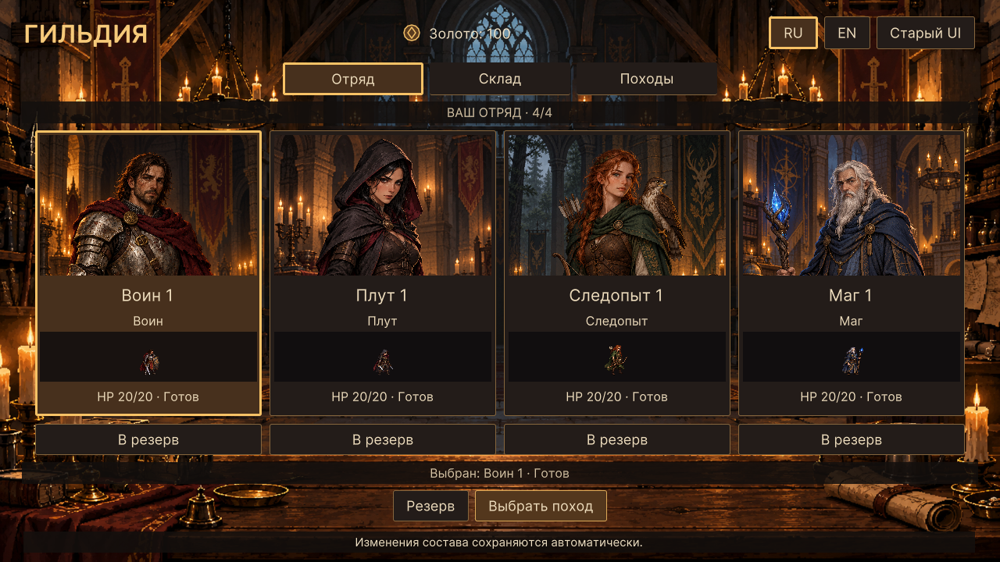

# WP-34 — визуальный состав отряда

Реализация: 16.10.2026, Unity 6000.2.8f1.

## Запуск и границы

Обычный Play в `Assets/Scenes/TacticalPrototype.unity` открывает новый экран
отряда. Иллюстрированный зал, вкладки и золото используют основу WP-33.
Четыре карточки показывают реальных выбранных героев: имя/номер, класс,
HP и состояние. Выбранная карточка выделяется рамкой. Миниатюры берутся из
`UnitSpriteSheet.Frame(Idle, 0)`, как в бою; анимация относится к WP-37.
Атласы не копируются и не меняются.

«В резерв» освобождает место. Пустая карточка или кнопка «Резерв» открывает
прокручиваемую панель всего списка. В ней можно осмотреть героя и добавить его
в отряд. Сначала освободите место, если уже выбраны четыре бойца. Погибших и
потерянных добавить нельзя. Выбор резервиста, прокрутка и состав сохраняются
при перестройке UI, смене языка и закрытии панели. Esc сначала закрывает резерв
с возвратом фокуса, затем возвращает на вкладку отряда, затем — к старому UI.

Основная кнопка ведёт к простому списку существующих предложений походов.
Обе кнопки перехода/отправления учитывают `Guild.CanLaunch`; причина отказа
видна в постоянной нижней строке. Команды состава идут через
`GuildState.TryToggleSelection`, запуск — через `GameBootstrap.TryLaunchExpedition`.
Новый экран автоматически возвращается после завершения экспедиции.

Подробности, найм, лечение и развитие добавлены в WP-35: [UI_HERO.md](UI_HERO.md).
Вкладка склада содержит явную ссылку на старый интерфейс (WP-36). Художественный
выбор похода — WP-38; здесь только переход к действующим предложениям.
Вернуться из старого UI можно кнопкой «Отряд (WP-34)» внизу экрана.
Мастерская WP-33 также открывается из старого UI.

## Устройство

`GuildPartyScreen` владеет отдельным UIDocument/копией PanelSettings и использует
общие UiComponents, Foundation.uss и GuildParty.uss. Документ расположен отдельным
корнем сцены: вложенный UIDocument наследует панель мастерской, которая может
быть скрыта. Bootstrap явно создаёт и уничтожает экран.

Состояние хранится по ID героя, а не индексу списка. Подписка `Guild.Changed`
переносится при замене гильдии; перестройка откладывается до Update, возвращает
фокус и прокрутку. Сгенерированные Sprite освобождаются при уничтожении экрана.
UiInputGate блокирует старые экраны и карту; кадр закрытия тоже поглощается.
Отключение компонента освобождает владение вводом. RNG и схема сохранения прежние.

Существующие batch-проверки начинают со старой презентации, чтобы их игровые
команды не блокировал открытый экран гильдии. WP-34 runner явно открывает новый UI.

## Проверки

`GuildTactics.Editor.GuildPartyChecks.RunBatch` — без `-quit`/`-nographics`.
Проверяются реальные панели/NavigationSubmitEvent и Play Mode:

- 0, 1 и 4 героя, пустые слоты и запрет обхода правил старта;
- два воина с разными ID, четыре кадра общего UnitSpriteSheet;
- резерв, Esc, возврат фокуса/выбора и 20 переключений презентации;
- загрузка 88 героев, раненый, возвращённое тело и окончательная потеря;
- прокрутка большого резерва без сброса при выборе;
- сохранение/загрузка изменённого состава во временном файле;
- RU/EN, 1280×720 и 1920×1080, отсутствие наложений/обрезки текста,
  длинное имя с многоточием и полной подписью в подсказке/резерве;
- отправление через UI, возврат после поражения, новая гильдия и освобождение ввода.

Результаты: `Logs/wp34-party.log`, снимки `Logs/wp34-*.png`.
Общая регрессия: `HexPresentationChecks.RunBatch`, `Logs/wp34-regression.log`.
Снимки главного экрана и большого резерва просмотрены визуально; копии основного
экрана — в UI_REFERENCES. Ручное прохождение мышью и отдельная Windows-сборка
в этом пакете не выполнялись. Известная блокировка UnityLinker политикой хоста
из предыдущих пакетов не перепроверялась.

