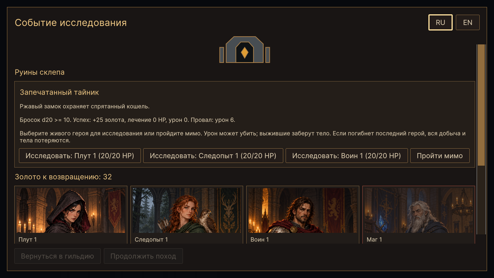
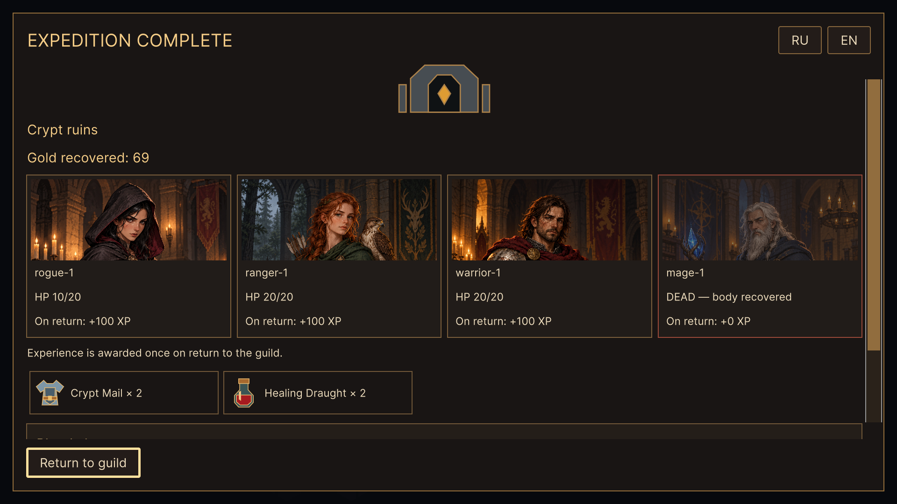
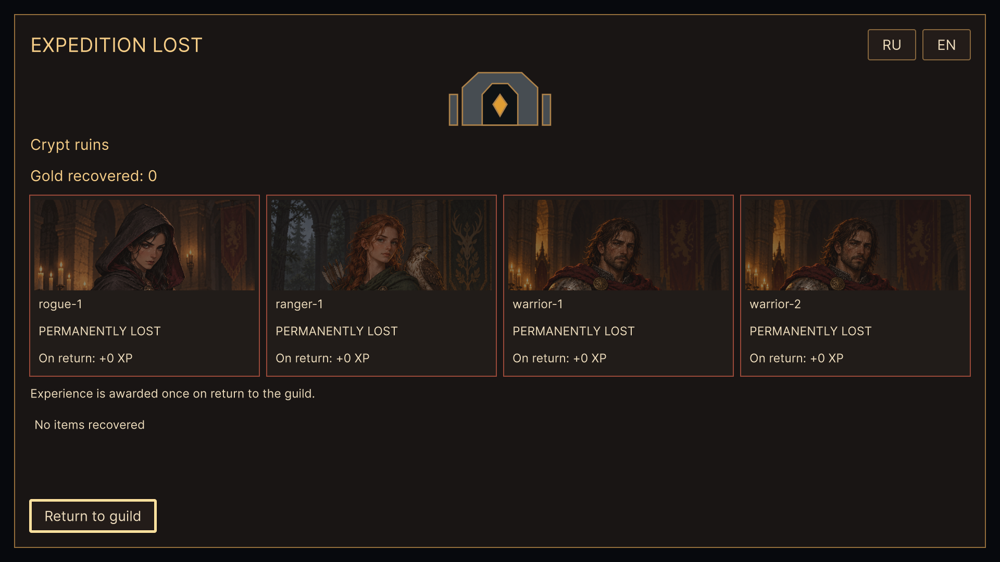
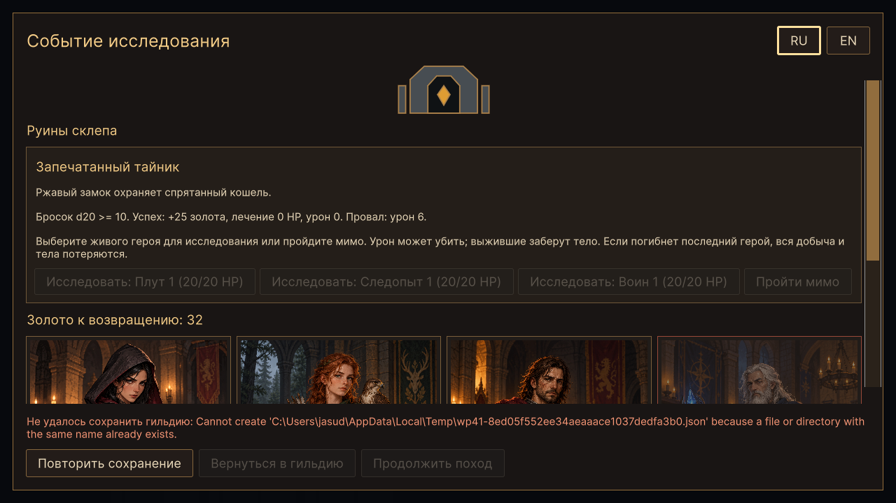

# WP-41 — события, переходы и результаты похода

Реализация: 17.10.2026, Unity 6000.2.8f1.

`JourneyScreen` объединяет события на границе участков, переход дальше,
подтверждение отступления/безвозвратной потери тела и результат похода.
Используются общий UI Toolkit, шрифты и золотые рамки, существующие иллюстрации
биомов, портреты классов и ItemIcon. Новых событий, правил наград и изменений
формата сохранения нет.

## Поведение

- На событии показаны реальное описание, сложность d20, последствия успеха
  и неудачи, живые кандидаты с HP и возможность пройти мимо. До записи
  контрольной точки выбор заблокирован. После команды виден фактический
  бросок и эффект из `LastEvent`; повторный выбор не исполняется.
- После выбора в начале экрана стоят награда и портреты: текущий HP,
  возвращённое тело либо окончательная потеря, опыт при возвращении. Опыт
  рассчитывается из существующих констант и оставшегося места до лимита.
  Он не начисляется за каждый участок и не начисляется погибшим.
- Добыча показана иконками реальных типов и количеством одинаковых вещей.
  Детали последнего события идут ниже итогов; длинный экран прокручивается,
  а кнопки возврата/продолжения остаются внизу окна.
- Награды остаются в ExpeditionJourney до `TryReturnToGuild`. Экран не
  изменяет золото, опыт, инвентарь и статусы героев самостоятельно.
  Возврат открывает существующую гильдию и склад с обновлёнными данными.
- Успех, отступление и поражение имеют путь в гильдию. Последний участок
  не предлагает продолжение. Непройденное событие требует явного выбора.
- Отступление показывает `PreviewRetreat` и потерю награды текущего участка;
  накопленное с прошлых участков отражается в итоговых золоте/предметах.
  Подтверждение оставления тела перечисляет последствия из существующей модели.
  Отмена/Esc возвращает прежний бой без расхода действия или движения.

## Ввод и защита команд

`UiInputGate.JourneyOpen` блокирует карту, камеру и игровые команды на время
экрана. BattleHud уступает ему отображение. При подтверждении флаг временно
снимается только на синхронный вызов существующей команды контроллера;
после этого закрывающий кадр остаётся заблокированным. Отмена восстанавливает
HUD и его фокус. Esc не выбирает героя, не подтверждает потерю и не закрывает
обязательное событие; подтверждения имеют отмену мышью и клавиатурой.

Кнопки фиксируют корень экрана, контроллер, границу и результат. Старое или
повторное событие не может выдать вторую награду, запустить следующий участок
или применить эффект к другой экспедиции. UI не расходует боевой RNG;
бросок исследования выполняет существующий детерминированный метод модели.

## Сохранение и совместимость

Ошибка записи контрольной точки видна над кнопками; повтор использует
`RetryJourneySave`, не повторяя событие. После ошибки записи при возврате
из похода сообщение остаётся в гильдии. `RetryGuildSave` сохраняет уже
полученное состояние через существующий SaveProgress, без повторного расчёта
наград. Кнопка доступна и на складе.

В batch старые проверки по умолчанию сохраняют прежнюю презентацию;
JourneyScreenChecks включает новую явно. Прежние ExpeditionUI/JourneyUI
и их отладочные сценарии сохранены. В Debug Mode новый экран позволяет
перейти к старому UI; кнопка `UI (WP-41)` возвращает новую презентацию.
Восстановленная граница работает и без ActiveController/объектов старого боя.

## Файлы

- `Assets/Scripts/UI/JourneyScreen.cs`, `Assets/Resources/UI/Journey.uss` —
  события, результаты, портреты/предметы, подтверждения, фокус и команды.
- `GameBootstrap.cs` — создание/очистка экрана и повтор сохранения гильдии.
- `ExpeditionUI.cs` — передача подтверждений новой презентации.
- `UiInputGate.cs`, `BattleHud.cs` — владение вводом и переключение HUD.
- `GuildPartyScreen.cs` — повтор записи с видимой ошибкой после возврата.
- `Assets/Editor/JourneyScreenChecks.cs` — реальная сцена и полный UI-сценарий.
- AGENTS, README, UI_ROADMAP, UI_DESIGN, TECHNICAL_NOTES и снимки — документация.

## Проверки

`GuildTactics.Editor.JourneyScreenChecks.RunBatch`, с `-batchmode`, без
`-quit` и `-nographics`. Используется отдельный временный файл гильдии;
пользовательское сохранение не читается и не изменяется.

Play Mode прошёл четыре запуска с одной гильдией:

1. Отступление: открытие, блокировка карты/действий, Esc, восстановление HUD,
   повторное открытие, двойное подтверждение и двойной возврат. Проверены
   25 опыта и реальная запись состояния.
2. Поход через два участка: погибший маг и возвращаемое тело, сундук и выход,
   ошибка записи границы, запрет обхода, повтор сохранения, пропуск события,
   повторная кнопка и переоткрытие экрана без выдачи награды. Из файла загружена
   граница, старый бой удалён, вызван настоящий RestoreJourney; новый экран
   продолжил поход с тремя живыми героями. На финальном событии исследование
   выполнилось один раз. Проверены золото, иконки/количество добычи, 100 опыта,
   тело на базе, ошибка финальной записи, её повтор и загрузка оплаченной
   гильдии без старой контрольной точки. Предметы найдены в настоящем складе.
3. Возвращённый маг воскрешён для следующего запуска; его невосстановимое тело
   проверено на отмене и подтверждении потери. Оно осталось Lost в гильдии.
4. Гибель всего отряда, отсутствие добычи, портреты погибших и возврат в гильдию.

Проверены RU/EN и 1280×720/1920×1080, геометрия подписей, закреплённые кнопки,
снимки результата/события/отступления/ошибки. Первые прогоны уточнили фикстуру
после извлечения (SelectedUnit уже null) и выявили сжатие подписи предмета;
карточки добычи получили явную ширину и перенос текста. После исправлений
JourneyScreenChecks прошёл целиком. Снимки просмотрены визуально.

Регрессии: BattleHudChecks и полный HexPresentationChecks с проверками
WP-00–19, WP-21–32 и расчёта WP-40. Логи: `Logs/wp41-ui-final.log`,
`Logs/wp41-hud-regression.log`, `Logs/wp41-regression-final.log`.
Ручной прогон мышью/клавиатурой и отдельная Windows-сборка не выполнялись;
сквозная ручная приёмка player остаётся WP-42. Перезапуск приложения заменён
удалением объектов боя и вызовом реального восстановления из записанного файла.

