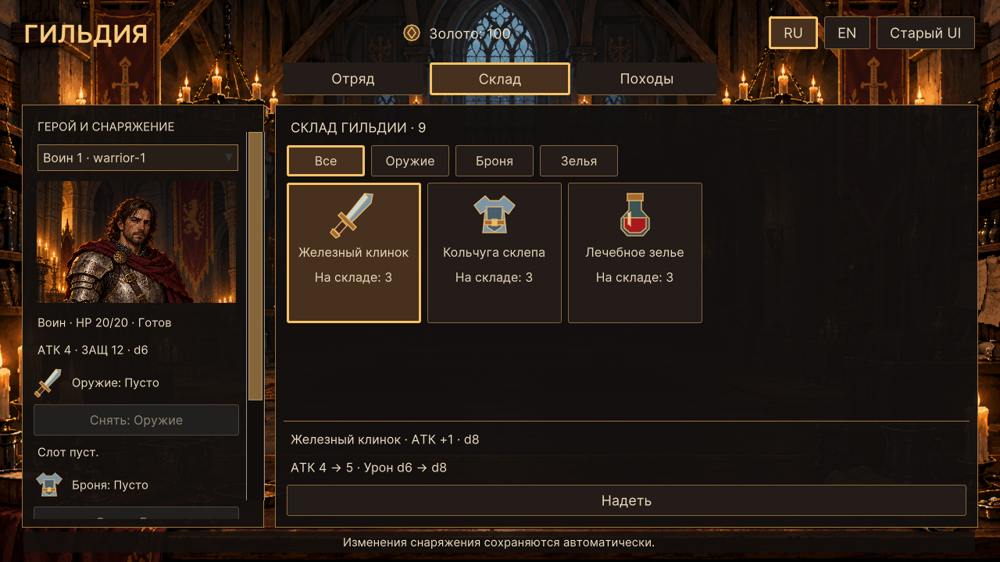
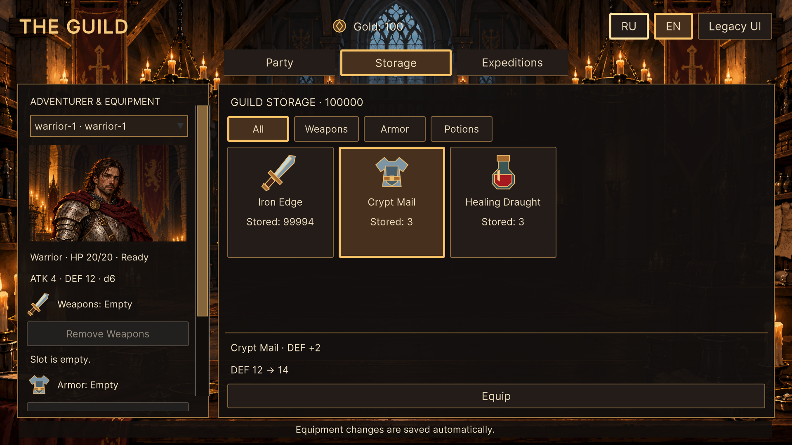

# WP-36 — склад и снаряжение

Реализация: 17.10.2026, Unity 6000.2.8f1.

Вкладка «Склад» показывает героя слева, его оружие, броню и запас зелий.
Героя можно сменить в списке, включая резерв. Иллюстрация использует существующий
портрет класса. Статус и характеристики берутся из текущего GuildAdventurer.

Справа — сетка вещей с отдельными иконками клинка, кольчуги и лечебного зелья.
Фильтры соответствуют трём существующим ItemCategory. Одинаковые экземпляры
собраны в одну плитку со счётчиком свободных копий. Надетые вещи остаются видны
с пометкой «У героев», даже если свободных экземпляров нет; выбор показывает
имена и ID владельцев. Пустой склад и пустой фильтр имеют явные подписи.

Выбор вещи показывает её эффект и сравнение атаки/кости урона либо защиты
с учётом обучения и текущего снаряжения. «Надеть» переносит свободную копию
через TryEquip, «Снять» возвращает её через TryUnequip. Передать занятую вещь
можно, сняв её у владельца и выбрав другого героя. Зелья используют существующий
TryTransferPotion: одно нажатие переносит одну штуку, вместимость — два.
Описание поясняет лечение владельца и расход действия в бою.

Недоступные действия сопровождаются видимой причиной: погибший герой, пустой
слот, нет свободной копии, вещь уже надета, запас зелий заполнен. Изменения модели
перестраивают склад; существующая подписка GameBootstrap сохраняет изменения.
После команды элементы сразу отключаются до следующей перестройки, исключая
двойную передачу по повторному событию. Устаревшая команда повторно проходит
проверку модели и показывает отказ. Смена героя до перестройки также отклоняет
команду прежнего героя. Вкладки сохраняют выбор; прокрутка снаряжения и сетки
сохраняется при обновлении. Колонка героя, сетка и подробности прокручиваются
отдельно, чтобы длинный список владельцев не вытеснял управление.

## Файлы и границы

- `GuildStorage.cs` — отдельная часть GuildPartyScreen, только презентация и команды модели.
- `ItemIcon.cs` — оригинальные векторные иллюстрации UI Toolkit Painter2D, 64 px в сетке и 40 px в слотах.
- `GuildStorage.uss` — композиция и стили, включая тёмный список выбора героя.
- `GuildPartyScreen.cs` — подключение вкладки, стилей, прокрутки и сообщений сохранения.
- `GuildStorageChecks.cs` — Play Mode сценарии реальных событий интерфейса.

Новые предметы, игровые правила и схема сохранений не добавлялись. Большой запас
агрегируется по реальным типам: 100000 вещей не создают 100000 UI-элементов.
Существующий каталог содержит три вещи; сетка допускает перенос строк и прокрутку.
Получение наград полным новым пользовательским путём относится к WP-41.
Анимация миниатюр и новый экран походов остаются WP-37 и WP-38.

## Проверки

`GuildTactics.Editor.GuildStorageChecks.RunBatch` запускается с `-batchmode`,
без `-quit` и `-nographics`. Использует настоящую сцену, NavigationSubmitEvent,
DropdownField и временные файлы сохранений. Проверяет пустой/заполненный склад,
все фильтры, экипировку и бонусы, передачу владельцу, двойные и устаревшие события,
лимит и возврат зелий, запрет для тела/потерянного героя, смену вкладок,
точное сохранение/загрузку и запас из 100000 предметов. Геометрия и подписи
проверяются на RU/EN при 1280×720 и 1920×1080, включая изменение размера и прокрутку.

Лог: `Logs/wp36-storage.log`, снимки: `Logs/wp36-*.png`.
Регрессии: `Logs/wp36-party-regression.log`, `Logs/wp36-hero-regression.log`,
`Logs/wp36-regression.log`. Итог прогона записан в TECHNICAL_NOTES.md.
Ручной прогон мышью и отдельная Windows-сборка в этом пакете не выполнялись.

Результат: все перечисленные прогоны прошли. Снимки в двух разрешениях
просмотрены визуально; представительные сохранены в UI_REFERENCES.

